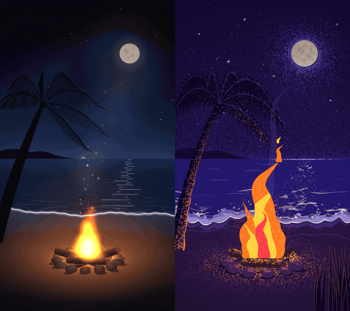

# Animation Taste

Un skill pour Claude (et les autres agents IA) qui arrête les animations « Claude de plus » : mêmes dégradés lisses, mêmes cartes qui flottent, même look moyen. Il te fait diriger l'animation comme un directeur artistique : une image de référence, un premier jet, des retours précis, et des tours jusqu'à ce que ce soit beau.

**[Télécharger le skill en ZIP](https://github.com/AISTUDIOOSS/animation-taste/archive/refs/heads/main.zip)**, aucun compte nécessaire.

## Ce qu'il fait

- Tu lui donnes **ce qu'il faut animer et une image de référence** (une image de film, une affiche, une illustration que tu aimes).
- Il lit la référence (palette, lumière, texture) et fait un premier jet dans un seul fichier HTML, en le disant franchement : « premier jet, il va être moyen ».
- Il fige des images de sa propre animation et les juge avec une grille en 7 points (couleur, lumière, texture, formes, mouvement, cadrage, taille), puis transforme « c'est moche » en consignes précises.
- Il applique un guide de goût pour le **rendu** (12 images par seconde, boucle parfaite, pas de zoom ni de fondu), le **grain** (3 couches qui font « imprimé ») et le **mouvement de la flamme** (elle se tord, elle ne gonfle pas).
- Deux styles inclus : le feu de camp (dessin plat et granuleux) et le collage papier pour les animations de Reels face caméra.

## Installer

**Claude Code** : copie le dossier `animation-taste` dans `~/.claude/skills/`. Ou envoie ce message à Claude :

> Installe le skill Animation Taste : télécharge https://github.com/AISTUDIOOSS/animation-taste/archive/refs/heads/main.zip, copie le dossier animation-taste dans ~/.claude/skills/, puis dis-moi quand c'est prêt.

**Claude.ai / Claude Desktop** : Réglages → Capacités → Skills → importer le dossier `animation-taste` en ZIP.

**Codex** : copie le dossier `animation-taste` dans `~/.codex/skills/`.

Ouvre ensuite une nouvelle conversation et écris par exemple : « Utilise le skill animation taste : anime une tasse de café qui fume sur une table, dans le style de cette image » (et joins ton image).

## Contenu

| Fichier | Rôle |
|---|---|
| `animation-taste/SKILL.md` | La méthode en 4 étapes |
| `animation-taste/gout.md` | Le goût : rendu, couleur, grain, lumière, flamme, collage papier |
| `animation-taste/critique.md` | La grille pour juger un jet et les phrases qui corrigent chaque défaut |
| `animation-taste/exemples/feu-premier-jet.html` | Le feu de camp, premier jet brut |
| `animation-taste/exemples/feu-dirige.html` | Le même feu, version dirigée : la barre à atteindre |
| `animation-taste/exemples/comparaison.html` | Les deux côte à côte |

Les exemples s'ouvrent d'un double-clic dans un navigateur. Ajoute `#t=1.5` à la fin de l'adresse pour figer l'image à 1,5 seconde.

## Limites

- Le skill ne remplace pas ton œil : il te donne les mots pour dire ce qui ne va pas. Compte 3 à 5 tours par animation.
- Les animations sont en HTML. Pour les mettre dans un montage, enregistre-les image par image depuis l'adresse `#t=` (le skill explique comment).

Fait par [AI Studio](https://www.ai-studio-os.com). Licence MIT.
